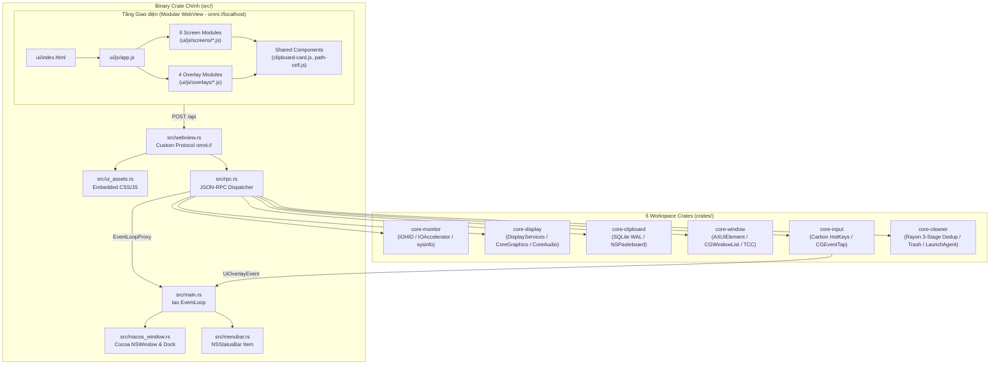

# 🏛️ Kiến trúc Hệ thống (`docs/ARCHITECTURE.md`)

Tài liệu này mô tả chi tiết kiến trúc phân tầng của **Mac Omni Tool**, cách thức giao tiếp giữa tầng giao diện WebView và các thư viện Rust nội bộ, cũng như cơ chế quản lý bộ nhớ **Zero-RAM-Leak** trên macOS.

---

## 1. Sơ đồ Kiến trúc Tổng thể

---

## 2. Phân tách Trách nhiệm trong Binary Crate (`src/`)

Thay vì gộp chung trong một tệp `main.rs`, tầng khởi chạy ứng dụng được chia thành 8 module rõ ràng:

| Module | File | Trách nhiệm chính |
| :--- | :--- | :--- |
| **Events** | [`src/events.rs`](file:///Users/khacthang/Documents/project/Rust-learn/mac-omni-tool/src/events.rs) | Định nghĩa `AppUserEvent`, `ScreenshotSlotData`, `ActiveScreenshotSession` dùng chung giữa các luồng nền và `tao` EventLoop. |
| **Single Instance** | [`src/single_instance.rs`](file:///Users/khacthang/Documents/project/Rust-learn/mac-omni-tool/src/single_instance.rs) | Sử dụng `flock(LOCK_EX \| LOCK_NB)` trên `/tmp/com.khacthang.mac-omni-tool.instance.lock` để ngăn macOS tạo 2 tiến trình khi khởi động lại máy. |
| **macOS Window** | [`src/macos_window.rs`](file:///Users/khacthang/Documents/project/Rust-learn/mac-omni-tool/src/macos_window.rs) | Tương tác trực tiếp Objective-C `NSApplication` / `NSWindow`: ẩn/hiện icon trên Dock (`NSApplicationActivationPolicyAccessory`), làm trong suốt viền bo góc (`CALayer.cornerRadius` + `masksToBounds`), đỗ cửa sổ overlay ra ngoài màn hình (`-20000, -20000` kèm `setIgnoresMouseEvents:YES`), và chia trực tiếp cửa sổ chính bằng `[NSWindow setFrame:display:animate:]`. |
| **Menu Bar** | [`src/menubar.rs`](file:///Users/khacthang/Documents/project/Rust-learn/mac-omni-tool/src/menubar.rs) | Tạo `NSStatusItem` (`❖`) trên thanh Menu Bar cạnh biểu tượng Pin của macOS và cập nhật nhiệt độ / `% CPU` thời gian thực. |
| **UI Assets** | [`src/ui_assets.rs`](file:///Users/khacthang/Documents/project/Rust-learn/mac-omni-tool/src/ui_assets.rs) | Nhúng tĩnh toàn bộ các tệp `ui/index.html`, `ui/styles/*.css`, `ui/js/**/*.js` vào bộ nhớ binary qua `include_str!` để `.app` chạy độc lập không phụ thuộc đường dẫn ngoài. |
| **RPC Dispatcher** | [`src/rpc.rs`](file:///Users/khacthang/Documents/project/Rust-learn/mac-omni-tool/src/rpc.rs) | Giải mã yêu cầu JSON-RPC `ApiRequest { cmd, payload }` và điều phối tới 6 crate lõi hoặc gửi sự kiện `AppUserEvent` về luồng giao diện. |
| **WebView Builder** | [`src/webview.rs`](file:///Users/khacthang/Documents/project/Rust-learn/mac-omni-tool/src/webview.rs) | Đăng ký giao thức tùy chỉnh `omni://localhost` phục vụ `/api`, `/screenshot_*.png` và các tài nguyên CSS/JS từ `ui_assets`. |
| **Main Event Loop** | [`src/main.rs`](file:///Users/khacthang/Documents/project/Rust-learn/mac-omni-tool/src/main.rs) | Khởi tạo nhóm cửa sổ (Menu Bar Popover, Main Dashboard, Clipboard Drawer, Alt-Tab Overlay, 4 Screenshot Overlay Slots) và điều phối sự kiện cửa sổ. |

---

## 3. Phân tách 6 Thư viện Lõi (`crates/`)

Mỗi thư viện trong `crates/` đều tuân theo chuẩn cấu trúc Rust chuyên nghiệp:
- `ffi.rs`: Khai báo `extern "C"` tới các C/Objective-C frameworks của Apple.
- `models.rs`: Các cấu trúc dữ liệu `Serialize` / `Deserialize` (`serde`).
- Các module nghiệp vụ tách biệt theo từng chức năng.
- `lib.rs`: Tái xuất (`pub use`) API sạch sẽ kèm bộ **Unit Tests (`#[cfg(test)]`)**.

### 3.1. `core-monitor` (`crates/core-monitor/src/`)
- [`ffi.rs`](file:///Users/khacthang/Documents/project/Rust-learn/mac-omni-tool/crates/core-monitor/src/ffi.rs): Liên kết `IOHIDEventSystemClient` (đọc cảm biến nhiệt độ SMC/PMU trên Apple Silicon) và Objective-C `autoreleasepool`.
- [`sensors.rs`](file:///Users/khacthang/Documents/project/Rust-learn/mac-omni-tool/crates/core-monitor/src/sensors.rs): Đọc, lọc trùng và phân loại các cảm biến nhiệt độ (`CPU/SoC`, `GPU`, `Battery/PMU`) + thông tin nguồn Pin (`pmset -g batt`).
- [`gpu.rs`](file:///Users/khacthang/Documents/project/Rust-learn/mac-omni-tool/crates/core-monitor/src/gpu.rs): Truy vấn `ioreg -r -d 1 -w 0 -c IOAccelerator` với bộ đệm TTL 3 giây để lấy `% GPU Device Utilization`, `% Renderer`, `% Tiler`, số nhân GPU và dung lượng Unified VRAM đang dùng / đã cấp.
- [`processes.rs`](file:///Users/khacthang/Documents/project/Rust-learn/mac-omni-tool/crates/core-monitor/src/processes.rs): Thu thập, sắp xếp tiến trình (`ram`, `cpu`, `disk`, `name`) và gửi tín hiệu `SIGKILL` / `SIGTERM` an toàn.
- [`dashboard.rs`](file:///Users/khacthang/Documents/project/Rust-learn/mac-omni-tool/crates/core-monitor/src/dashboard.rs): Cung cấp `get_hardware_dashboard()` (chỉ quét `ProcessRefreshKind` nhẹ gồm CPU, Memory, DiskUsage) và `get_menubar_stats()` (siêu nhẹ, không quét danh sách tiến trình khi cửa sổ chính đang ẩn).

### 3.2. `core-display` (`crates/core-display/src/`)
- [`brightness.rs`](file:///Users/khacthang/Documents/project/Rust-learn/mac-omni-tool/crates/core-display/src/brightness.rs): Điều khiển độ sáng phần cứng (`DisplayServicesGetBrightness` / `DisplayServicesSetBrightness` + `IODisplaySetFloatParameter`) và bộ lọc màu Gamma LUT (`CGSetDisplayTransferByFormula`).
- [`appearance.rs`](file:///Users/khacthang/Documents/project/Rust-learn/mac-omni-tool/crates/core-display/src/appearance.rs): Kiểm tra và chuyển đổi chế độ Sáng/Tối của macOS.
- [`screenshot.rs`](file:///Users/khacthang/Documents/project/Rust-learn/mac-omni-tool/crates/core-display/src/screenshot.rs): Xác định màn hình chứa con trỏ chuột (`get_display_at_mouse_cursor`) và chụp ảnh màn hình gốc độ phân giải Retina (`CGDisplayCreateImage` -> PNG) bọc trong `objc_autoreleasePoolPush/Pop`.
- [`audio.rs`](file:///Users/khacthang/Documents/project/Rust-learn/mac-omni-tool/crates/core-display/src/audio.rs): Liệt kê và chuyển đổi thiết bị âm thanh đầu ra/đầu vào (`AirPods`, `Bluetooth`, `Built-in Speaker`, `HDMI`) qua `CoreAudio`.

### 3.3. `core-clipboard` (`crates/core-clipboard/src/`)
- [`codec.rs`](file:///Users/khacthang/Documents/project/Rust-learn/mac-omni-tool/crates/core-clipboard/src/codec.rs): Hàm băm `fnv1a_hash` và bộ mã hóa/giải mã Base64 chuẩn không cần thư viện ngoài.
- [`storage.rs`](file:///Users/khacthang/Documents/project/Rust-learn/mac-omni-tool/crates/core-clipboard/src/storage.rs): Cơ sở dữ liệu SQLite (`WAL` mode) lưu tối đa 1,000 mục, tự động cắt tỉa các mục cũ chưa ghim và dọn tệp ảnh PNG mồ côi trên đĩa.
- [`pasteboard.rs`](file:///Users/khacthang/Documents/project/Rust-learn/mac-omni-tool/crates/core-clipboard/src/pasteboard.rs): Luồng theo dõi `NSPasteboard.generalPasteboard` mỗi 250ms bọc trong `objc_autoreleasePoolPush/Pop`, hỗ trợ dán tự động (`Cmd+V` qua `CGEventPost`).

### 3.4. `core-window` (`crates/core-window/src/`)
- [`shortcuts.rs`](file:///Users/khacthang/Documents/project/Rust-learn/mac-omni-tool/crates/core-window/src/shortcuts.rs): Lưu trữ, kiểm tra xung đột và khôi phục 16 phím tắt chia cửa sổ.
- [`tiling.rs`](file:///Users/khacthang/Documents/project/Rust-learn/mac-omni-tool/crates/core-window/src/tiling.rs): Tính toán tọa độ `SnapRect` và di chuyển/thay đổi kích thước cửa sổ đang mở bằng Accessibility API (`AXUIElementSetAttributeValue`) kèm fallback AppleScript (`System Events`).
- [`switcher.rs`](file:///Users/khacthang/Documents/project/Rust-learn/mac-omni-tool/crates/core-window/src/switcher.rs): Liệt kê danh sách cửa sổ kèm ảnh thu nhỏ Live Preview (`CGWindowListCreateImage`) cho hộp thoại Alt-Tab.
- [`permissions.rs`](file:///Users/khacthang/Documents/project/Rust-learn/mac-omni-tool/crates/core-window/src/permissions.rs): Kiểm tra và mở bảng cấp quyền `Accessibility`, `Screen Recording`, `Full Disk Access` và làm mới TCC (`tccutil reset`).

### 3.5. `core-input` (`crates/core-input/src/`)
- [`config.rs`](file:///Users/khacthang/Documents/project/Rust-learn/mac-omni-tool/crates/core-input/src/config.rs): Chuẩn hóa chuỗi phím tắt (`canonicalize_shortcut`), ánh xạ mã phím sang Carbon & CGEventFlags, và lưu cấu hình JSON.
- [`carbon_hotkeys.rs`](file:///Users/khacthang/Documents/project/Rust-learn/mac-omni-tool/crates/core-input/src/carbon_hotkeys.rs): Đăng ký phím tắt toàn cục ở cấp hệ điều hành (`RegisterEventHotKey`) cho cả Clipboard, F3, 3 chế độ chụp màn hình và toàn bộ 16 phím tắt chia cửa sổ (hoạt động ngay cả khi chưa bật Accessibility).
- [`event_tap.rs`](file:///Users/khacthang/Documents/project/Rust-learn/mac-omni-tool/crates/core-input/src/event_tap.rs): Vòng lặp `CGEventTap` bắt tổ hợp nhấn đồng thời Chuột Trái + Chuột Phải, chặn `Cmd+Tab` để mở Alt-Tab Live Preview, và biến `Cmd+X` -> `Cmd+V` trong Finder thành lệnh di chuyển tệp (`Cmd+Option+V`).

### 3.6. `core-cleaner` (`crates/core-cleaner/src/`)
- [`trash_and_junk.rs`](file:///Users/khacthang/Documents/project/Rust-learn/mac-omni-tool/crates/core-cleaner/src/trash_and_junk.rs): Quét song song (`rayon`) các thư mục bộ nhớ đệm và quản lý Thùng rác `~/.Trash`.
- [`duplicates.rs`](file:///Users/khacthang/Documents/project/Rust-learn/mac-omni-tool/crates/core-cleaner/src/duplicates.rs): Thuật toán tìm tệp trùng lặp 3 giai đoạn (Nhóm theo kích thước -> Băm nhanh 8KB đầu/cuối -> Băm toàn bộ nội dung FNV-1a 64-bit) với lớp bảo vệ tuyệt đối cho các tệp cơ sở dữ liệu nội bộ.
- [`uninstaller.rs`](file:///Users/khacthang/Documents/project/Rust-learn/mac-omni-tool/crates/core-cleaner/src/uninstaller.rs): Quét `/Applications`, trích xuất biểu tượng `.icns` -> PNG (`sips`) và tìm toàn bộ tệp phụ liên quan trong `~/Library`.
- [`scan_manager.rs`](file:///Users/khacthang/Documents/project/Rust-learn/mac-omni-tool/crates/core-cleaner/src/scan_manager.rs): Quản lý tiến trình quét ngầm có thanh phần trăm (`%`) và bộ nhớ đệm kết quả quét.

---

## 4. Cơ chế Chống Tràn RAM (Zero-Memory-Leak Architecture)

1. **Ở tầng Rust (`core-monitor`, `core-clipboard`, `core-display`, `core-window`)**:
   - Mọi hàm gọi tới Objective-C (`NSString`, `NSData`, `NSBitmapImageRep`, `NSPasteboard`, `NSWorkspace`) và CoreFoundation (`CFArray`, `CFDictionary`, `CGImage`) trong các luồng lặp đều được bọc trong `objc_autoreleasePoolPush()` / `objc_autoreleasePoolPop()` và `CFRelease()`.
   - Khi làm mới danh sách tiến trình mỗi 1–2 giây, `core-monitor` sử dụng `ProcessesToUpdate::All` (tự động xóa các tiến trình đã tắt khỏi bảng băm của `sysinfo`) kết hợp `light_process_refresh_kind()` (không nạp lại biến môi trường hoặc đường dẫn thực thi dài ở mỗi chu kỳ).
   - Menu Bar Popover sử dụng lệnh riêng `get_menubar_stats` chỉ đọc tải CPU, RAM và cảm biến nhiệt độ mà không quét bảng tiến trình.
2. **Ở tầng WebView DOM (`ui/js/screens/hardware-monitor.js`)**:
   - Thay vì gán lại `tbody.innerHTML = ...` mỗi 2 giây khiến WebKit tích tụ các cây DOM bị tách rời (Detached DOM Nodes) và closure sự kiện, `syncProcessRowsDom()` tái sử dụng trực tiếp các thẻ `<tr class="proc-row">` đang có, cập nhật `textContent` / `style.width` tại chỗ và gọi `tbody.removeChild()` ngay lập tức với các dòng thừa.
   - Sự kiện nút **Force Quit** được gắn một lần duy nhất trên `tbody` (Event Delegation).

